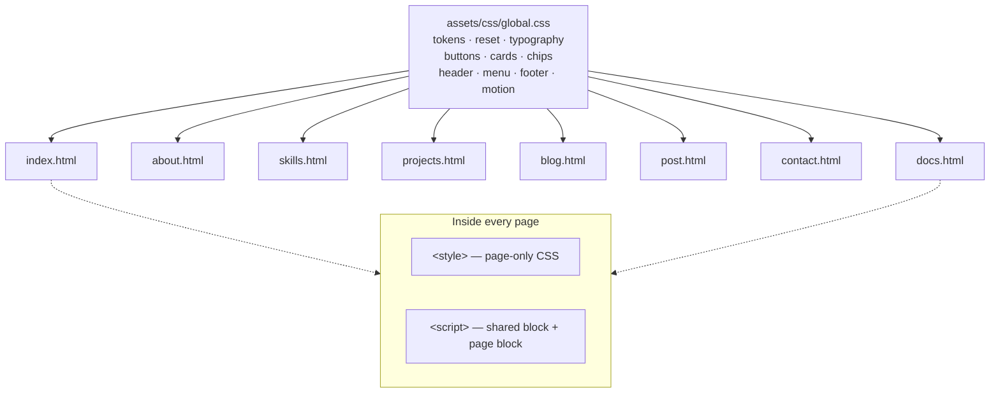
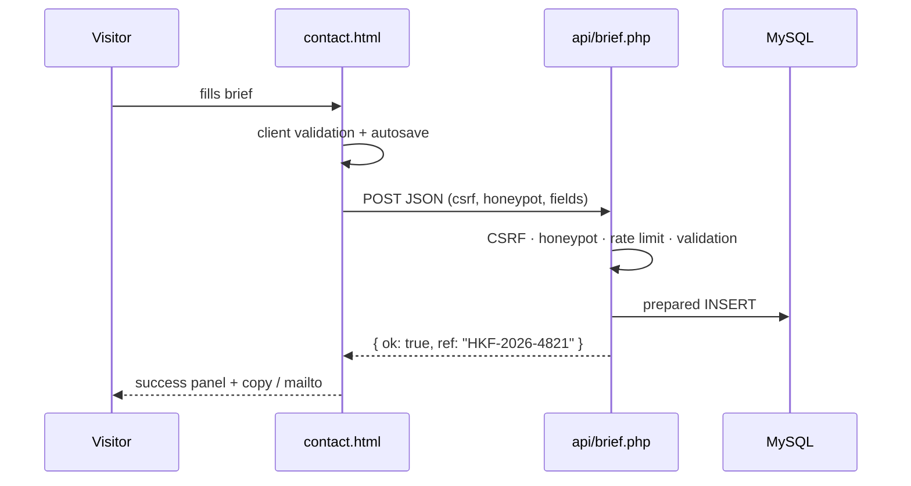

<div align="center">

<br>

```text
  >_  H E Y D A R   K F
      personal portfolio template
```

# HeydarKF — Portfolio Template

**A premium, zero-dependency personal site template.**
Soft gradients · subtle glass · asymmetric layouts · live design tokens.

*Beyond code. Into engineering.*

<br>

[](#-license)
[](#-quick-start)
[](#-quick-start)
[](#-architecture)
[](#-theme-system)
[-101413?style=flat-square)](#-internationalization--rtl)
[](#-accessibility)
[](#-contributing)

<br>

[**Live demo**](https://heydar.kazemifakhr.ir) ·
[**Documentation**](https://heydar.kazemifakhr.ir/docs.html) ·
[**Token Studio**](https://heydar.kazemifakhr.ir/docs.html#sec-studio) ·
[**Report a bug**](../../issues/new)

<br>

<picture>
  <source media="(prefers-color-scheme: dark)" srcset="assets/preview/banner-dark.png">
  
</picture>

<sub>Drop your captures into <code>assets/preview/</code> — see <a href="#-screenshots">Screenshots</a>.</sub>

</div>

<br>

---

## 📑 Table of contents

- [Why this template](#-why-this-template)
- [At a glance](#-at-a-glance)
- [Quick start](#-quick-start)
- [Project structure](#-project-structure)
- [Architecture](#-architecture)
- [Pages](#-pages)
- [Design system](#-design-system)
- [Signature features](#-signature-features)
- [Deep links & shortcuts](#-deep-links--shortcuts)
- [Local storage](#-local-storage)
- [Customization](#-customization)
- [Backend wiring](#-backend-wiring)
- [Security & CSP](#-security--csp)
- [Accessibility](#-accessibility)
- [Performance](#-performance)
- [Browser support](#-browser-support)
- [Deployment](#-deployment)
- [Internationalization & RTL](#-internationalization--rtl)
- [Screenshots](#-screenshots)
- [Troubleshooting](#-troubleshooting)
- [Roadmap](#-roadmap)
- [Contributing](#-contributing)
- [License](#-license)
- [Author](#-author)

---

## ✨ Why this template

Most portfolio templates are a hero, three cards and a contact form. This one is a **small design system** with eight finished pages built on top of it.

| | |
|---|---|
| 🎛️ **Live Token Studio** | A permanently visible control panel with 13 tuners — accent, radius, blur, grain, mesh, shadows, width, type scale, motion — that repaints the page in real time and **exports production CSS**. |
| 🧩 **One kit, eight pages** | Every button, chip, card and header comes from a single `global.css`. Change a token once, the whole site follows. |
| 🧱 **Layouts with a rhythm** | Asymmetric 70/30 hero, bento services, staggered work grid, packed 12-column blog mosaic — no three-equal-cards monotony. |
| 🎬 **Motion that behaves** | FLIP re-layout, one-time scroll reveals, counters, typewriter, scroll-driven progress — all disabled under `prefers-reduced-motion`. |
| 📖 **A real reading experience** | Blog reader + single-post page with sticky TOC, progress rail, font-size stepper, code copy, print styles and local comments. |
| 🔒 **Security-minded** | Documented CSP, a hardened PHP endpoint recipe (CSRF · honeypot · rate limit · prepared statements), `noopener` everywhere. |
| 🌍 **EN + FA ready** | Ships LTR English; the Persian docs page is a working RTL reference built on the same stylesheet. |
| 🪶 **Nothing to install** | No npm, no bundler, no framework. Open the folder and it runs. |

---

## 📊 At a glance

| Metric | Value |
|---|---|
| Pages | **8** (`index` · `about` · `skills` · `projects` · `blog` · `post` · `contact` · `docs`) |
| Shared stylesheets | **1** (`assets/css/global.css`) |
| npm dependencies | **0** |
| Build steps | **0** |
| Design tokens | **22+**, light & dark |
| Themes | **2**, persisted, no flash |
| Demo projects | **7** (6 gallery + 1 featured) |
| Demo essays | **9**, full text included |
| Skills catalogued | **22** across 5 domains |
| Storage keys | **10**, all UI preferences |
| Locales | **EN** (LTR) + **FA** (RTL) reference |

---

## 🚀 Quick start

```bash
# 1 — clone
git clone https://github.com/heydarkf/heydarkf-template.git
cd heydarkf-template

# 2 — serve (pick one; there is no build)
php -S localhost:8000
# or
npx serve .
# or
python3 -m http.server 8000

# 3 — open
open http://localhost:8000
```

> **Why a server?** Opening via `file://` renders fine, but the Clipboard API and some storage behaviour are restricted. Use `localhost` or HTTPS while developing.

**Requirements:** a browser and any static file server. Fonts load from Google Fonts; offline, system fallbacks apply and nothing breaks. Self-host them for full offline parity — see [Performance](#-performance).

---

## 📁 Project structure

```text
heydarkf-template/
├── index.html              # home — asymmetric hero, bento, staggered work
├── about.html              # story, timeline, values, toolbox, off-the-clock
├── skills.html             # 5 domains, 22 skills, services, process
├── projects.html           # filterable mosaic + index view + detail modal
├── blog.html               # search / filter / sort + inline reader
├── post.html               # single essay (?p=slug) with TOC & rail
├── contact.html            # 6-step brief form, autosave, live status
├── docs.html               # this manual, with the live Token Studio
├── assets/
│   ├── css/
│   │   └── global.css      # ← the only shared file: tokens + UI kit
│   ├── preview/            # README screenshots (add yours)
│   └── og-cover.png        # 1200×630 social card
├── fa/                     # optional Persian mirror (see i18n)
├── 404.html                # optional — recipe in docs §19
├── robots.txt
├── sitemap.xml
├── LICENSE
└── README.md
```

Each page carries its **own** `<style>` and `<script>` block, so any single file can be lifted out and still work.

---

## 🏗 Architecture

Three deliberate layers:



**Rules that keep it maintainable**

1. Only genuinely shared things go into `global.css`.
2. Page CSS uses a semantic prefix (`.work-*`, `.svc-*`, `.brief-*`, …).
3. Never put an `id` inside `.mock` or `.cv` — those nodes are **cloned** into modals, previews and covers.
4. Every `data-slug` element must have a matching entry in that page's data object.

---

## 📄 Pages

| File | Route | What's inside |
|---|---|---|
| `index.html` | `/` | Floating header · asymmetric hero with typing terminal · skills marquee · bento services + sticky stats rail · staggered work · wide CTA |
| `about.html` | `/about.html` | Offset portrait frame + rotating seal · narrative with pull quote · sticky desk still-life · scroll-filled timeline · values · toolbox chips · tea counter |
| `skills.html` | `/skills.html` | Terminal manifest · sticky domain nav with scrollspy · 22 skill meters with proof links · services & pricing · 4-step process · learning rail |
| `projects.html` | `/projects.html` | Featured case · sticky filters with FLIP · mosaic **and** index view with cursor-following preview · challenge → solution → result modal · building-now |
| `blog.html` | `/blog.html` | Masthead · featured spread · live search + category filter + sort · packed asymmetric grid · collections · newsletter · full reader |
| `post.html` | `/post.html?p=slug` | Progress bar · floating reading rail · sticky TOC · rich article · share · author · prev/next · related · local comments · print CSS |
| `contact.html` | `/contact.html` | Live status card (Qom clock) · 6-step brief with autosave & validation · direct line · FAQ · elsewhere cards |
| `docs.html` | `/docs.html` | 21-section manual · **live Token Studio** · searchable TOC · copyable code · tabs · print styles |

---

## 🎨 Design system

### Palette

| Swatch | Token | Light | Dark | Role |
|---|---|---|---|---|
|  | `--accent` | `#009966` | `#009966` | Buttons, active links, key icons — **accent only, never a page background** |
|  | `--accent-ink` | `#007a52` | `#3ecf9a` | Small accent text, AA-safe |
|  | `--bg` | `#f6f8f7` | `#0b0f0e` | Page surface |
|  | `--ink` | `#101413` | `#edf2f0` | Primary text |
|  | `--teal` | `#2b7f8c` | — | Subject accent (charts, covers) |
|  | `--amber` | `#d8b56a` | — | "In progress" states |
|  | `--crimson` | `#d64550` | — | Errors, security severity |

### Core tokens

```css
:root {
  /* accent */
  --accent:        #009966;
  --accent-strong: #00b377;
  --accent-deep:   #007a52;
  --accent-ink:    #007a52;
  --accent-soft:   rgba(0, 153, 102, .10);
  --accent-line:   rgba(0, 153, 102, .28);
  --on-accent:     #052018;

  /* surfaces & text */
  --bg: #f6f8f7;  --bg-2: #eef1f0;  --surface: #ffffff;
  --ink: #101413; --muted: #5b6562; --faint: #8d9793;
  --line: rgba(16,20,19,.09); --line-2: rgba(16,20,19,.16);

  /* glass */
  --glass: rgba(255,255,255,.62);
  --glass-line: rgba(255,255,255,.65);
  --glass-blur: 18px;

  /* shape & space */
  --r-sm: 12px; --r-md: 20px; --r-lg: 24px; --r-pill: 999px;
  --container: 1200px;
  --gutter: clamp(20px, 4vw, 32px);
  --header-offset: 118px;

  /* type */
  --font-display: "Space Grotesk", "Inter", sans-serif;
  --font-body:    "Inter", sans-serif;
  --font-mono:    "JetBrains Mono", monospace;

  /* motion */
  --ease: cubic-bezier(.22,.61,.36,1);
  --t-fast: .25s; --t-med: .45s;
}
```

<details>
<summary><b>Dark overrides</b></summary>

```css
[data-theme="dark"] {
  --accent-ink:  #3ecf9a;
  --accent-soft: rgba(0,201,138,.12);
  --accent-line: rgba(0,201,138,.30);

  --bg: #0b0f0e; --bg-2: #121716; --surface: #141a18;
  --ink: #edf2f0; --muted: #9aa5a0; --faint: #6d7773;
  --line: rgba(237,242,240,.09); --line-2: rgba(237,242,240,.17);

  --glass: rgba(18,23,22,.58);
  --glass-line: rgba(237,242,240,.10);
}
```
</details>

### UI kit

| Class | Purpose |
|---|---|
| `.container` / `.section` | Width + responsive gutter / vertical rhythm |
| `.card` | Glass surface, 24px radius, hover lift + shadow |
| `.btn` `.btn-primary` `.btn-ghost` `.btn-sm` `.btn-lg` | Pill buttons with accent shadow |
| `.icon-btn` | Circular 42px control |
| `.chip` `.tag` `.badge` | Mono chips, tech tags, pulsing availability badge |
| `.kicker` `.h2` `.h3` `.display` | Editorial headings with rule prefix |
| `.section-head` `.link-arrow` | Title left / action right, sliding arrow link |
| `.marquee` | Seamless strip — **duplicate the group** |
| `.reveal` + `--d` | One-time entrance with per-item delay |

```html
<div class="card reveal" style="--d:120ms">
  <p class="kicker">01 — what I do</p>
  <h2 class="h2">Services, engineered end-to-end.</h2>
  <a class="btn btn-primary" href="contact.html">Start a project</a>
</div>
```

---

## 🎛 Signature features

### Token Studio (`docs.html`)

A permanently visible panel — never hidden in a modal — that repaints the live page:

| Control | Range |
|---|---|
| Accent color | picker + hex field + 8 presets |
| Accent text mode | `auto` (contrast-safe) · `deep` · `bright` |
| Corner radius | 6 – 32 px |
| Glass blur | 0 – 34 px |
| Glass opacity | 20 – 95 % |
| Grain / noise | 0 – 14 % |
| Mesh intensity | 0 – 24 % |
| Shadow depth | flat · soft · deep |
| Container width | 1000 – 1480 px |
| Font scale | 88 – 118 % |
| Motion speed | calm · normal · snappy · off |
| Grid paper | on / off |
| Theme | light / dark |

**Actions:** reset · randomize · **Copy CSS** · **Download `heydarkf-tokens.css`**.
Settings persist locally; the token table in the docs is a live readout of the current values.

### Projects gallery

- **FLIP animation** — cards measure before/after and animate to their new positions; the grid height animates too, so nothing jumps.
- **Two real layouts** — mosaic (asymmetric spans) and index (editorial list with a **cursor-following preview** cloned from the card art).
- **Sparse-aware packing** — 1 or 2 results re-flow into a deliberate composition instead of a broken row.
- **Detail modal** — challenge → solution → result, metrics, quote, stack, demo/source links, prev/next, copy link, hash deep-linking, full-screen on mobile.

### Blog & reader

- Live search with **match highlighting**, category filter with counts, three sort modes, collection filters.
- Asymmetric 12-column grid packed by JS so **every filter result still fills its rows**.
- Reader with font-size stepper, progress %, copy link, prev/next, deep links; essays live in `<template>` elements so content is real HTML, not JSON strings.

### Single post

Sticky TOC with scrollspy · reading progress · floating rail (top · A+ / A− · copy · print · %) · code blocks with copy buttons · callouts, tables, footnotes · share to X/LinkedIn · bookmark · related essays scored by category, series and tags · local comments with like/delete · dedicated print stylesheet.

### Contact

Six-step progress meter · service multi-picker · budget segments · timeline slider · character counter · consent gate · inline validation with focus management · **draft autosave + restore** · reference number on success · copy-brief and `mailto:` fallbacks · prefill via `?service=`.

> Submission is **simulated on the front end** by design. Wire it to your own endpoint — see [Backend wiring](#-backend-wiring).

---

## 🔗 Deep links & shortcuts

| URL | Result |
|---|---|
| `projects.html#sentinel` | Opens that project's modal |
| `blog.html#agents-contracts` | Opens the reader on that essay |
| `post.html?p=p95-promise` | Renders that single essay |
| `contact.html?service=security` | Preselects a service |
| `docs.html#sec-tokens` | Jumps to a docs section |

| Key | Action |
|---|---|
| `/` | Focus search (blog, docs) |
| `Esc` | Close modal / menu, or clear search |
| `←` `→` | Previous / next project inside the modal |
| `[` `]` | Previous / next docs section |
| `Tab` | Trapped inside open dialogs, restored on close |

**Demo slugs**

```text
projects : sentinel · atlas · nexus · pulse · transit · mehrab · ledger
essays   : frameworks-behind · bug-threat-model · agents-contracts ·
           reading-code-classics · p95-promise · validation-boundary ·
           caching-contract · notebook-terminal · forty-line-container
```

---

## 💾 Local storage

Nothing sensitive is ever stored — these are UI preferences only.

| Key | Store | Contents |
|---|---|---|
| `hkf-theme` | local | Chosen theme |
| `hkf-view` | local | Gallery layout (mosaic / index) |
| `hkf-fs` | local | Reader font size |
| `hkf-sub` | local | Newsletter state |
| `hkf-bookmarks` | local | Bookmarked essay slugs |
| `hkf-comments-<slug>` | local | Comments per essay |
| `hkf-brief-draft` | local | Contact form draft |
| `hkf-briefs-sent` | local | Submitted brief history |
| `hkf-docs-studio` | local | Token Studio settings |
| `hkf-tea` | **session** | About-page tea counter |

<details>
<summary><b>Reset everything</b></summary>

```js
Object.keys(localStorage)
  .filter(k => k.startsWith('hkf-'))
  .forEach(k => localStorage.removeItem(k));
sessionStorage.removeItem('hkf-tea');
location.reload();
```
</details>

---

## 🛠 Customization

### Rebrand in 60 seconds

1. Open `docs.html` → **Token Studio**.
2. Tune accent, radius, blur, grain, motion until it feels like you.
3. Hit **Copy CSS** and replace the token block in `assets/css/global.css`.

> Terminal scenes and cover art use fixed hues (`#0d1512`, `#3ecf9a`, `#d8b56a`, `#2b7f8c`, `#4f83c2`, `#d64550`). Search-and-replace them in the page CSS for a full rebrand.

### Add a project

1. Copy a `<article class="card work-card …" data-slug data-cat>` into `#mosaic`.
2. Pick a size: `--xl` · `--sm` · `--md` · `--wide`.
3. Add the matching `.index-row`.
4. Add `PROJECTS[slug]` with `challenge / solution / result / metrics / quote / demo / source`.
5. Update the filter counts.

**Real screenshots instead of CSS mockups:** inside `.work-media`, swap `.mock` for
``.
Keep `.work-veil` and `.work-go` — the modal clones the media node, so photos carry over.

### Add an essay

```html
<article class="post-card card reveal"
         data-slug="my-post" data-cat="security"
         data-date="2026-12-01" data-mins="5" data-span="4"> … </article>

<template id="tpl-my-post">
  <div class="tpl-lede">One-paragraph introduction…</div>
  <div class="tpl-body"><p>…</p><h2 id="section-one">…</h2></div>
</template>
```

Then mirror the slug in `post.html` → `META[]` **and** add a `<template id="tpl-my-post">` there.
Reading time is recomputed from the word count automatically.

### Add a page

Copy an existing page → update meta/canonical/JSON-LD → move `aria-current="page"` → rewrite the page `<style>` and page JS → add the link to desktop nav, mobile menu and footer. Full skeleton in `docs.html` §18.

---

## 🔌 Backend wiring

The contact form ships front-end only. Here is a hardened PHP endpoint and the fetch that replaces the simulated submit.



<details>
<summary><b>api/brief.php</b></summary>

```php
<?php
declare(strict_types=1);
session_start();
header('Content-Type: application/json; charset=utf-8');

if ($_SERVER['REQUEST_METHOD'] !== 'POST') { http_response_code(405); exit; }

$in = json_decode(file_get_contents('php://input'), true) ?: [];

// CSRF
if (!hash_equals($_SESSION['csrf'] ?? '', $in['csrf'] ?? '')) {
  http_response_code(419); echo json_encode(['error' => 'csrf']); exit;
}

// Honeypot — silently accept bots
if (!empty($in['website'])) { echo json_encode(['ok' => true]); exit; }

// Rate limit: 3 per 10 minutes per session
$now = time();
$_SESSION['hits'] = array_values(array_filter($_SESSION['hits'] ?? [], fn($t) => $now - $t < 600));
if (count($_SESSION['hits']) >= 3) { http_response_code(429); exit; }
$_SESSION['hits'][] = $now;

// Validation
$name  = trim($in['name']  ?? '');
$email = trim($in['email'] ?? '');
$msg   = trim($in['msg']   ?? '');
if (mb_strlen($name) < 2 || !filter_var($email, FILTER_VALIDATE_EMAIL) || mb_strlen($msg) < 30) {
  http_response_code(422); echo json_encode(['error' => 'validation']); exit;
}
if (preg_match('/[\r\n]/', $email . $name)) { http_response_code(422); exit; } // header injection

// Storage
$pdo = new PDO('mysql:host=localhost;dbname=hkf;charset=utf8mb4', 'user', 'pass', [
  PDO::ATTR_ERRMODE => PDO::ERRMODE_EXCEPTION,
  PDO::ATTR_EMULATE_PREPARES => false,
]);
$ref = 'HKF-' . date('Y') . '-' . random_int(1000, 9999);
$pdo->prepare('INSERT INTO briefs (ref,name,email,services,budget,timeline,body,created_at)
               VALUES (?,?,?,?,?,?,?,NOW())')
    ->execute([$ref, $name, $email, implode(', ', $in['services'] ?? []),
               $in['budget'] ?? '', $in['time'] ?? '', $msg]);

// Notify — PHPMailer recommended in production
$safe = htmlspecialchars($name, ENT_QUOTES, 'UTF-8');
mail('hello@kazemifakhr.ir', "[$ref] Project brief", "$safe <$email>\n\n$msg",
     "From: noreply@kazemifakhr.ir\r\nContent-Type: text/plain; charset=utf-8");

echo json_encode(['ok' => true, 'ref' => $ref]);
```
</details>

<details>
<summary><b>contact.html — replace the simulated submit</b></summary>

```js
const res = await fetch('/api/brief.php', {
  method: 'POST',
  headers: { 'Content-Type': 'application/json' },
  credentials: 'same-origin',
  body: JSON.stringify({
    csrf: CSRF_TOKEN,          // injected server-side
    website: '',               // honeypot — must stay empty
    name: fName.value.trim(),
    email: fEmail.value.trim(),
    services, budget,
    time: TIME_LABELS[+fTime.value],
    msg: fMsg.value.trim()
  })
});
if (!res.ok) { showToast('Send failed — please retry'); return; }
const { ref } = await res.json();
// …then render the existing success panel with the real ref
```
</details>

**Newsletter** and **comments** are intentionally local-first. Point them at your own store when you're ready — the UI states (subscribed, undo, like, delete) already exist.

---

## 🔐 Security & CSP

The template uses inline `<style>` / `<script>`. This policy is compatible as shipped:

```http
Content-Security-Policy:
  default-src 'self';
  script-src 'self' 'unsafe-inline';
  style-src 'self' 'unsafe-inline' https://fonts.googleapis.com;
  font-src 'self' https://fonts.gstatic.com;
  img-src 'self' data:;
  connect-src 'self';
  form-action 'self';
  base-uri 'self';
  frame-ancestors 'none';
  object-src 'none'
```

For a strict policy, move page CSS/JS into `assets/` and switch to nonces or hashes (`script-src 'self' 'nonce-…'`).

**Checklist**

- [x] Validate on the server, not only the client
- [x] Prepared statements for every query
- [x] `htmlspecialchars` on output
- [x] CSRF token + honeypot + rate limiting
- [x] Strip `\r\n` from anything used in mail headers
- [x] `rel="noopener"` on every external link
- [x] No secrets in `localStorage`
- [ ] HTTPS + HSTS and `HttpOnly; Secure; SameSite=Lax` session cookies *(your server)*

---

## ♿ Accessibility

- Skip link, visible `:focus-visible` rings, `aria-current` navigation.
- Dialogs: `role="dialog"`, `aria-modal`, focus trap, focus restore, `Esc` to close.
- `aria-pressed` on filters and toggles, `aria-label` on every icon-only control.
- Live regions (`aria-live="polite"`) for counters, results and toasts.
- Small accent text uses `--accent-ink`; button text is dark on accent to clear **AA**.
- Every animation collapses under `prefers-reduced-motion: reduce`.
- Content remains readable with JavaScript disabled.

---

## ⚡ Performance

- Zero framework, zero bundler; one shared stylesheet plus page CSS.
- Fonts: `preconnect` + `display=swap`. Self-host `woff2` to remove the last external request.
- Animations touch only `transform` / `opacity`; scroll work is rAF-throttled and `passive`.
- Observers `unobserve` after their first trigger; counters and typewriters run once.
- Mockups are CSS/SVG — no image weight. When you add photos: `loading="lazy"`, explicit `width`/`height`, AVIF/WebP.
- `backdrop-filter` and the grain layer cost GPU: lower blur/grain in the Studio for low-end devices.

**Suggested budget:** LCP < 2.0 s on 4G, CLS ≈ 0, JS < 40 KB per page (uncompressed). Measure on your own content — the demo copy is not your copy.

---

## 🌐 Browser support

| Feature | Status | Fallback |
|---|---|---|
| Recent Chrome / Edge / Firefox / Safari | ✅ Full | — |
| `backdrop-filter` | ✅ Widely supported | Semi-opaque surface remains |
| View Transitions API | 🟡 Progressive | CSS cross-fade |
| Web Animations API | ✅ Widely supported | Instant, still correct filtering |
| `IntersectionObserver` | ✅ Widely supported | Everything reveals immediately |
| `100dvh` | ✅ Modern mobile | Fixed-height fallback |
| JavaScript disabled | ✅ Readable | Filters/modals inactive |

---

## 🚢 Deployment

<details open>
<summary><b>Static hosts (Netlify · Vercel · GitHub Pages)</b></summary>

```bash
netlify deploy --prod --dir .
# or
vercel --prod
```
GitHub Pages → **Settings → Pages → Branch: `main` / root**. All paths are relative, so subfolder hosting works.
</details>

<details>
<summary><b>Apache / cPanel — .htaccess</b></summary>

```apache
ErrorDocument 404 /404.html

<IfModule mod_deflate.c>
  AddOutputFilterByType DEFLATE text/html text/css application/javascript image/svg+xml
</IfModule>

<IfModule mod_expires.c>
  ExpiresActive On
  ExpiresByType text/css "access plus 1 year"
  ExpiresByType application/javascript "access plus 1 year"
  ExpiresByType image/svg+xml "access plus 1 year"
  ExpiresByType text/html "access plus 0 seconds"
</IfModule>

<IfModule mod_headers.c>
  Header set X-Content-Type-Options "nosniff"
  Header set Referrer-Policy "strict-origin-when-cross-origin"
  Header set X-Frame-Options "DENY"
  Header set Strict-Transport-Security "max-age=31536000; includeSubDomains" env=HTTPS
</IfModule>
```
</details>

<details>
<summary><b>Nginx</b></summary>

```nginx
server {
  listen 443 ssl http2;
  server_name heydar.kazemifakhr.ir;
  root /var/www/hkf;
  index index.html;

  error_page 404 /404.html;
  location / { try_files $uri $uri/ =404; }

  gzip on;
  gzip_types text/css application/javascript image/svg+xml;

  location ~* \.(css|js|svg|woff2)$ {
    expires 1y;
    add_header Cache-Control "public, immutable";
  }
  add_header X-Content-Type-Options nosniff;
  add_header Referrer-Policy strict-origin-when-cross-origin;
}
```
</details>

---

## 🌍 Internationalization & RTL

The Persian documentation page is a **working RTL reference** built on the same `global.css`.

To create `fa/`:

1. Copy the pages into `fa/`.
2. `<html lang="fa" dir="rtl">`.
3. Swap Inter / Space Grotesk for **Vazirmatn**.
4. Zero the negative heading tracking; raise `line-height` to ≈ 1.9.
5. Convert directional rules:

| LTR | RTL |
|---|---|
| `.skip-link{left}` | `inset-inline-start` |
| `.lang-menu{right:0}` | `inset-inline-end:0` |
| `border-left` on quotes | `border-inline-start` |
| `padding-left` on lists | `padding-inline-start` |
| Marquee keyframes | invert direction |
| Code blocks | keep `direction:ltr; text-align:left` |

`hreflang` alternates and the language menu are already wired in both directions.

---

## 🖼 Screenshots

Add captures to `assets/preview/` and this table lights up.

| Light | Dark |
|---|---|
| `banner-light.png` | `banner-dark.png` |
| `home-light.png` | `home-dark.png` |
| `projects-light.png` | `projects-dark.png` |
| `blog-light.png` | `blog-dark.png` |
| `studio-light.png` | `studio-dark.png` |

Recommended: **1600×1000**, PNG or WebP, captured at 2× and downscaled.

---

## 🧯 Troubleshooting

| Symptom | Cause | Fix |
|---|---|---|
| Page has no styles | CSS path | Check `assets/css/global.css` relative to the file |
| Color flash on load | Missing head script | Add the anti-FOUC snippet (docs §07) |
| Content stays invisible | JS error / missing `.js` class | Check the console; the head script adds the class |
| Filter does nothing | `data-cat` mismatch | Button and card values must match |
| Project modal empty | Unknown slug | `data-slug` must exist in `PROJECTS` |
| Post always shows default | Slug missing | Add it to `META[]` **and** a `<template>` |
| Empty TOC | Headings lack `id` | Apply the auto-id patch (docs §19) |
| Copy button fails | Not on HTTPS/localhost | Serve the files; a fallback exists |
| Marquee jumps | Second group removed | Keep `.marquee-group` twice |
| Cards blurry / heavy | Too much blur | Lower blur and grain in the Studio |

---

## 🗺 Roadmap

- [x] Eight pages on one UI kit
- [x] Light / dark with no flash
- [x] FLIP filtering + mosaic / index views
- [x] Blog reader + single post with TOC
- [x] Live Token Studio with CSS export
- [x] Persian RTL reference
- [ ] `404.html` shipped by default *(recipe in docs §19)*
- [ ] Full `fa/` mirror of all pages
- [ ] Static generator for per-essay URLs (better indexing)
- [ ] `feed.xml` + JSON search index
- [ ] Optional PHP backend package (brief + newsletter + comments)
- [ ] Self-hosted `woff2` bundle

Have an idea? [Open an issue](../../issues/new).

---

## 🤝 Contributing

Contributions are welcome — bug fixes, accessibility improvements, new page patterns, translations.

```bash
git checkout -b feat/your-idea
# keep it dependency-free, keep tokens in global.css
git commit -m "feat(projects): add keyboard grid navigation"
git push origin feat/your-idea
```

**Guidelines**

- No new runtime dependencies. Vanilla only.
- Shared styles → `global.css`; page styles → the page's `<style>`.
- Every interactive control needs a focus state, an accessible name and a reduced-motion path.
- Test light **and** dark, desktop **and** mobile, with and without JS.
- Conventional commits: `feat` · `fix` · `docs` · `style` · `refactor` · `perf` · `a11y`.

---

## 📄 License

Released under the **MIT License** — use it personally or commercially, attribution appreciated but not required.

```text
MIT © Heydar Kazemi Fakhr (HeydarKF)
```

See [`LICENSE`](LICENSE) for the full text.

---

## 👤 Author

<div align="center">

**Heydar Kazemi Fakhr** — *HeydarKF*
Backend engineer & full-stack developer · seminary student

[](https://heydar.kazemifakhr.ir)
[](https://github.com/heydarkf)
[](https://www.linkedin.com/in/heydarkf)
[](https://x.com/heydarkf)
[](mailto:hello@kazemifakhr.ir)

<br>

```text
$ whoami
heydar_kf
$ cat stack.txt
php · mvc · ai-agents · security · linux
$ ./build --secure --scalable
✓ system engineered
```

<sub>Designed &amp; developed by <b>HeydarKF (OS Heydar)</b></sub>

<br>

**If this saved you a weekend, leave a ⭐**

</div>
